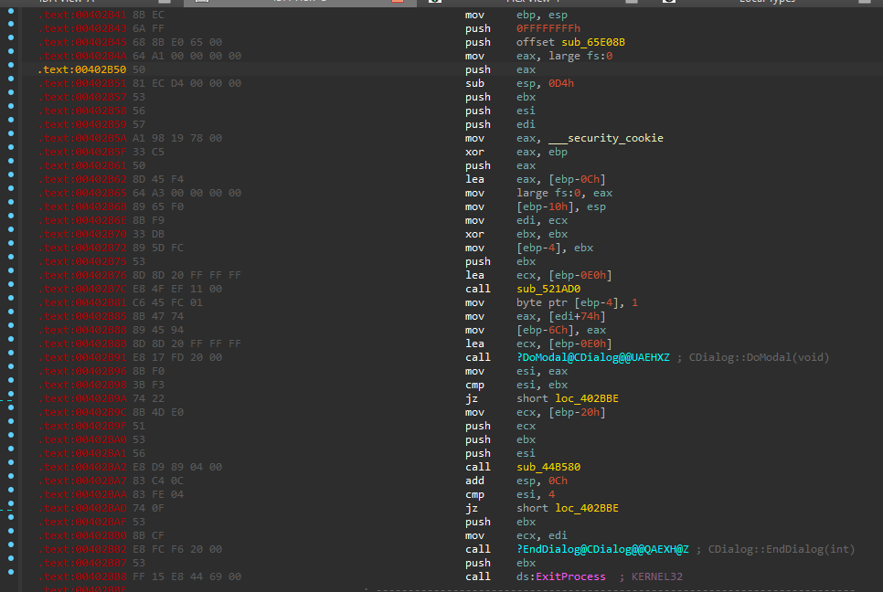
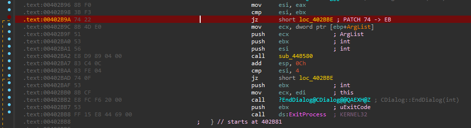
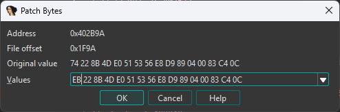

# idm-patcher

IDM 6.43 started flagging my serial as fake - warning box, forced exit,
registration dialog on top. So I patched it.

Three bytes across three sites in `IDMan.exe`, three registry values. That's it.

Tested on **6.43 build 10**. Different build? The tool tells
you and writes nothing.



`74 22` → `EB 22`:



IDA's byte editor - address `0x402B9A`, file offset `0x1F9A`:



---

## How IDM triggers the warning

On startup IDM calls the registration dialog and checks the return value:

```asm
00402B91   call  ?DoModal@CDialog      ; registration dialog, status -> eax
00402B96   mov   esi, eax
00402B98   cmp   esi, ebx              ; ebx = 0
00402B9A   jz    short 00402BBE        ; 0 = clean, skip the block
00402B9C   mov   ecx, [ebp-20h]
00402B9F   push  ecx
00402BA0   push  ebx
00402BA1   push  esi
00402BA2   call  sub_44B580            ; builds the "fake Serial Number" box
00402BA7   add   esp, 0Ch
00402BAA   cmp   esi, 4
00402BAD   jz    short 00402BBE
00402BAF   push  ebx
00402BB0   mov   ecx, edi
00402BB2   call  ?EndDialog@CDialog    ; dialog cleanup
00402BB7   push  ebx
00402BB8   call  ds:ExitProcess
```

Status `0` means nothing to report. Anything else builds the warning, and
anything that isn't `4` also calls `ExitProcess` - that's why IDM shuts down
after you press OK. (`?EndDialog@CDialog` above `ExitProcess` is just cleanup;
the actual message box is `sub_44B580`.)

## What gets changed

**Site 1 - warning branch**, file offset `0x1F9A`:

```
74 22   jz  →  EB 22   jmp
```

The healthy path is taken every time. The status value itself isn't touched, so
downloads, the scheduler, and browser integration all run as before.

**Site 2 - message builder**, file offset `0x4A980`:

```
6A FF 68 98   push -1 / push seh  →  31 C0 C3   xor eax,eax / ret
```

Every registration-status caller routes through here. It takes the status code
and picks which box to draw - fake serial, serial used on another machine, trial
and expiry reminders. Returning at the entry means none of those get built.
Callers that would have exited afterwards still exit, just without a box.

**Site 3 - registration dialog**, file offset `0x9AFEF`:

```
74 0D   jz  →  EB 0D   jmp
```

Sits in the command handler that opens the registration dialog -
`cmp [0x787380], 0` then `jz` past the builder call. Flipped, the dialog is
never built from that path. Worth knowing: the Registration menu item stops
doing anything when clicked.

**Registry** - `HKCU\Software\DownloadManager`:

| Value | Data |
|---|---|
| `FName` | `Catrine` |
| `LName` | `(omar)` |
| `LstCheck` | `12/06/6767` |

About window ends up showing:

```
Version: 6.43 Build 10 (08/20/2026) Full
This product is licensed to: Catrine (omar)
```

The version line comes from IDM itself. The stored serial and encrypted
registration blob are not touched.

## Why it works on other builds

No addresses are hardcoded - the ones above are just what it found on my copy.
All three anchor on *what the code calls*, not where the code lives.

**Status branch:**

1. Read the PE headers and import table
2. Find the IAT slot for `kernel32!ExitProcess`
3. Find every `FF 15 <slot>` call in the executable section
4. Walk backwards from each one and validate the shape:
   `call → mov r32, eax → cmp/test → short je` (long `jcc` handled too)
5. Require a second call between the branch and `ExitProcess` (the message box),
   and require the branch to land just past the `ExitProcess` call

**Message builder:** no separate scan. The first `call` between the status
branch and the `ExitProcess` call is the builder for that status, so its target
comes along with site 1 and gets the same treatment.

**Dialog skip:**

1. Find the IAT slot for `USER32!DialogBoxIndirectParamW`
2. Find `test eax, eax` / `jz` where the five bytes before are `call <something>`
3. Resolve that call target and require the function it lands in to reference
   `DialogBoxIndirectParamW` within its first 2 KB
4. Take the short `jz` sitting right before that call

The locators found exactly one site each in this build. If a future build
changes the shape of a block, the tool reports `no match for this build` and
writes nothing - it never patches on a guess.

## Usage

[IDMPatcher.exe](https://github.com/5k-omar/idm-patcher/releases/download/v1.0.0/IDMPatcher.exe) one file, 13 MB. No Python
needed. Double-click it, click through UAC, the window opens.

SmartScreen warns about an unknown publisher the first time - the exe isn't
signed. More info, Run anyway.

Built from `idm_patch.py` with:

```
pyinstaller --onefile --windowed --name IDMPatcher idm_patch.py
```

Or run the script directly, Python 3.9+ with `tkinter` (ships with the standard
Windows installer):

---

```
python idm_patch.py
```

Opens with the default IDM install path pre-filled. Before writing anything,
it shows the bytes it would change:

```
0x1f9a   status branch   before   74 22 8B 4D E0 51 53 56
                         after    EB 22 8B 4D E0 51 53 56
0x4a980  message box     before   6A FF 68 98 49 66 00 64
                         after    31 C0 C3 98 49 66 00 64
0x9afef  dialog skip     before   74 0D E8 AA D2 00 00 85
                         after    EB 0D E8 AA D2 00 00 85
3 bytes will change
```

An already-patched file shows the target bytes in both rows and says
`already patched`. An unrecognized build says so and doesn't offer a patch
button.

CLI:

```
python idm_patch.py --cli
python idm_patch.py --cli --restore
python idm_patch.py --cli --exe "D:\IDM\IDMan.exe"
```

UAC prompt on launch - the exe lives in Program Files, so the file write needs
admin. Registry writes don't. First patch saves `IDMan.exe.orig` next to the
exe; that backup is never overwritten, so restore always has something to work
with. IDM is closed before writing and left closed. Start it yourself.

## Verifying

**Start IDM.** No warning, no forced exit.

**About window** (`Help > About IDM`):

```
Version: 6.43 Build 10 (08/20/2026) Full
This product is licensed to: Catrine (omar)
```

**Registry:**

```
reg query "HKCU\Software\DownloadManager" /v FName
reg query "HKCU\Software\DownloadManager" /v LstCheck
```

## Manual patch in IDA

Load `IDMan.exe`, let analysis finish, `G` → `402B9A`. Set
`Options > General > Number of opcode bytes = 4` to show the byte column.

**Site 1 - warning branch:**

```asm
00402B98  cmp  esi, ebx
00402B9A  jz   short loc_402BBE     ; 74 22  →  EB 22
```

**Site 2 - message builder** (`G` → `4A980`):

```asm
0004A980  push  -1                  ; 6A FF  \
0004A982  push  offset seh_handler  ; 68 98  /  →  31 C0 C3  xor eax,eax / ret
```

**Site 3 - dialog skip** (`G` → `49BBEF`):

```asm
0049BBE8  cmp  dword ptr [0x787380], 0
0049BBEF  jz   short loc_49BBFE     ; 74 0D  →  EB 0D
0049BBF1  call sub_4A8EA0
0049BBF6  test eax, eax
0049BBF8  jz   loc_49BD0D
```

`Edit > Patch program > Change byte`, then
`Edit > Patch program > Apply patches to input file`. Same result, just slower.

## Rollback

```
python idm_patch.py --cli --restore
```

or the restore button. Copies `IDMan.exe.orig` back over the exe. Registry
values are left alone - delete manually if you want those gone:

```
reg delete "HKCU\Software\DownloadManager" /v FName /f
reg delete "HKCU\Software\DownloadManager" /v LName /f
reg delete "HKCU\Software\DownloadManager" /v LstCheck /f
```

## After an IDM update

Updating replaces `IDMan.exe`, so the patch is gone and the warning is back. Run
the tool again. If it returns `no match for this build`, the code changed enough
that the pattern doesn't line up - that build needs a fresh look, not a retry.

## Troubleshooting

**`no match for this build`** - Pattern not found, nothing was written. Check
the version in About and compare with the tested build listed above.

**`needs administrator`** - UAC was declined. Rerun and allow it.

**Warning or dialog still appears** - Check the bytes with the PowerShell line
above. Still `116` means the write didn't happen. `235` means IDM was already
running from before the patch - kill it and start it fresh.

**Name not in About** - Registry write failed, usually permissions on the key.
Set the value by hand with `reg add`.

## Discord

https://discord.gg/cW9DdBC5NY
